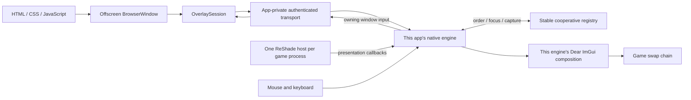

# Electron Game Overlay

Render Electron interfaces inside Windows games.

Your overlay remains an ordinary HTML/CSS/JavaScript application running in
Electron. The library captures offscreen `BrowserWindow` frames, composites
them on the game's Direct3D swap chain, and routes intercepted mouse and
keyboard input back to the correct Electron window.

## Support

| Area                         | Supported boundary                    |
| ---------------------------- | ------------------------------------- |
| Host                         | Windows 10 or newer, x64              |
| Electron                     | `>=39.1.0 <40` or exactly `46.0.0-alpha.2` |
| Target architecture          | x64 and x86/PE32                      |
| Graphics APIs                | Direct3D 9, 10, 11, and 12            |
| Existing official ReShade    | x64, when its public add-on API works |
| Multiple apps in one process | Cooperative native add-ons; exact PID recommended |
| Anti-cheat                   | Unsupported                           |

OpenGL, Vulkan, VR, and other Electron 40+ versions are not currently supported.

## How it works



The browser never runs inside the game. Electron renders each overlay page to
an offscreen bitmap in your application process. `OverlaySession` publishes
those frames, their bounds, visibility, and order through an application-private
transport to that application's native engine. Each engine owns its textures
and draws its windows through Dear ImGui during the game's normal presentation.

`ReShadeOverlayLauncher` connects the two sides. It must attach near process
creation, before the game creates the graphics device or swap chain. The
application does not select D3D9, D3D10, D3D11, or D3D12; the runtime observes
the API used by the target.

When input interception is enabled, supported game input is consumed by the
runtime and translated back to Electron. Hit testing, focus, text input,
scrolling, dragging, and normal DOM events continue to work in the overlay.

Independent applications can load their own SDK and native engine versions into
the same exact game process. They share one ReShade host and a small fixed-layout
coordination protocol for per-window order, focus, capture and interception.
Their transports, scene resources and feature implementations remain separate.
Normal SDK startup does not start a broker service or elect one application's
engine to serve the others.

## SDK distribution candidate

For a standalone consumer without the workspace build tools, use the local
`electron-game-overlay-0.1.0-rc.7.tgz` candidate artifact. This is not a public npm
release. Use an artifact built from the matching cooperative-implementation
revision; older artifacts with the same rc.7 label can contain the historical
broker implementation. Follow the [package install guide](libs/electron-game-overlay/README.md)
and copy [`examples/basic-overlay`](examples/basic-overlay) outside this checkout
before installing the tarball. The example includes a noninjecting Electron/DOM
smoke mode and an explicitly opted-in Windows name-watcher flow; it does not
attach to already-running games.

The [SDK API guide](doc/sdk-api.md) covers all three public entry points, managed
attachment, native allow/deny policy, read-only process observation and packaging.
Its retained broker sections describe the historical implementation; the active
multi-app contract is [cooperative add-ons](doc/cooperative-addons.md).
The [managed consumer](examples/managed-overlay)
is the starting example for applications that update targeting policy at runtime.

The validation app download below is a separate artifact, not the SDK tarball.

## Try a demo

### Download the Windows validation app

For a ready-to-run build of `apps/client`, open the **Broker compatibility**
GitHub Action, choose **Run workflow**, select the branch to test, and enable
**build-demo**. Demo packaging runs only for that explicit manual request;
ordinary pull-request checks do not build the Electron app.

Download `ElectronGameOverlayDemo-win32-x64.zip` from the completed run's
artifacts and extract the entire archive. No separate Node.js, Electron, or
native build tools are required. The bundle includes a dedicated Node runtime
for the Steam process watcher; it does not require `node` on your PATH. With the
target game closed, run
`Start Demo.cmd` as a normal user, then launch the game through Steam. The
launcher enables the bundled runtime and Steam auto-attachment. Use the tray's
Quit action to stop the demo. This is an unsigned testing build; elevated games
and anti-cheat-protected games are unsupported.

Normal demo runs save structured evidence under
`%APPDATA%\electron-game-overlay-demo\logs\compatibility-runs`. Quit through
the tray menu to finalize the matching `.events.jsonl` and `.summary.json`.
Saved events include bounded, allowlisted `errorMessage` summaries and Windows
error codes; raw commands, personal paths and unknown error text are omitted.

**Antivirus warning:** Microsoft Defender can flag and remove the demo's
temporary `inject.exe` helpers, causing attachment failures even when the
watcher is running. A tester confirmed that allowing the detected item restored
operation; this is not a verified false-positive determination. See the
[known antivirus issue](doc/known-issues.md#antivirus-detection-of-injection-helpers)
before overriding a detection. Do not disable antivirus or exclude your entire
Temp folder.

The workflow's **build-two-app-demo** and **Start Broker Test.cmd** lane retains
the historical broker/package comparison. It is separate from the new
[cooperative acceptance cases](doc/cooperative-addons-acceptance.md), which
record each app's own JavaScript/native implementation, private route and
survivor behavior.

### Run a focused example from source

On Windows, use a Node.js version in the workspace's supported range and the
[native build prerequisites](#build-and-test).
Install the workspace and prepare the runtime once:

```powershell
npm install
npm run demo:prepare
```

With the target game closed, start the basic example:

```powershell
npm run demo:basic-window -- --target-process="game.exe"
```

Wait for `Injector watcher ready`, then launch the game. The demo runner adds
`--reshade-overlay` for these CLI-based demos automatically; applications can
configure the SDK directly without a command-line flag, as shown below.

See [`demos`](demos) for all focused examples and their launch commands.
`apps/client` is the larger validation application, not the recommended place
to learn the SDK.

## Application setup

The SDK is used from Electron's main process. Disable Electron GPU acceleration
before `ready`, create one overlay session, create the offscreen windows you
want to publish, and attach a launcher to the target.

**Your application does not need a `--reshade-overlay` launch argument.** Use
`createReShadeLaunchConfig()` to opt in directly in code. It validates the bundled
runtime without starting a watcher or injecting anything; attachment starts
only when your application calls `attach()`.

```ts
import { app } from 'electron';
import path from 'node:path';
import {
  ElectronGameOverlay,
  ReShadeOverlayLauncher,
  isReShadeOperationError,
  createReShadeLaunchConfig,
} from 'electron-game-overlay';

app.disableHardwareAcceleration();

const config = createReShadeLaunchConfig();

const overlay = new ElectronGameOverlay();
const session = overlay.createSession();
const launcher = new ReShadeOverlayLauncher(config);

launcher.onEvent((event) => {
  if (event.type === 'injector-watcher-ready') {
    console.log('The watcher is ready; launch game.exe now.');
  }
});

app.on('before-quit', () => {
  session.input.release();
  launcher.dispose();
  overlay.dispose();
});

void app.whenReady().then(async () => {
  await Promise.all([session.whenReady(), launcher.prepare()]);

  const window = session.windows.create({
    id: 'main-overlay',
    bounds: { x: 48, y: 48, width: 480, height: 300 },
    captionHeight: 44,
    dragBorder: 8,
    transparent: true,
    file: path.join(__dirname, 'renderer', 'index.html'),
    browserWindow: {
      frame: false,
      transparent: true,
      backgroundColor: '#00000000',
      webPreferences: {
        preload: path.join(__dirname, 'preload.js'),
        contextIsolation: true,
        nodeIntegration: false,
        sandbox: true,
        backgroundThrottling: false,
      },
    },
  });

  window.show();

  const result = await launcher.attach(session, {
    processName: 'game.exe',
  });

  console.log(`Attached to PID ${result.pid} through ${result.runtimeMode}`);
});
```

Start the compiled Electron entry point normally; no overlay flag is needed:

```powershell
npx electron path\to\main.js
```

### Optional command-line opt-in

If your application should enable the overlay only when explicitly requested on
the command line, replace the `createReShadeLaunchConfig()` call above with:

```ts
import { parseReShadeLaunchConfig } from 'electron-game-overlay';

const config = parseReShadeLaunchConfig(process.argv);
if (!config) {
  throw new Error('Start Electron with --reshade-overlay to enable the overlay.');
}
```

For this CLI-based variant only, launch with:

```powershell
npx electron path\to\main.js --reshade-overlay
```

`--reshade-overlay` is an opt-in convention enforced by
`parseReShadeLaunchConfig()`, not a requirement of ReShade or of the SDK's
programmatic API. Without the flag, the parser returns `null`; an application
can skip overlay setup instead of throwing. Both configuration helpers perform
the same runtime validation, and neither starts attachment by itself.

For a production application, handle the rejected `attach()` promise and
surface diagnostics as shown below.

## Managed targeting and native policy

Use `createReShadeLaunchConfig()` for programmatic configuration and
`OverlayTargetWatcher` to own future observation and launcher lifetimes. Native
`earlyPolicy` supports explicit full-path allow/deny patterns without expanding
basenames in application code. `observeOverlayProcesses()` is the read-only
alternative for applications that need to own observation themselves.

A rule change preserves an already-authorized live overlay. If an uncertain
reservation prevents replacement discovery, `update()` emits `discovery-blocked`
and keeps the allowed target; it does not claim new readiness. Genuine denial
still cancels that target synchronously. Read the [current API contract](doc/sdk-api.md#managed-target-watcher)
before treating a resolved update as permission to launch another game.

`ready`/`armed` means discovery is available, not guaranteed attachment before
graphics startup. Native future polling remains intermittent for fast hosts.
Use exact PID/path identity when your application already observes processes.
Native attachment ownership is validated for the exact process incarnation in
every lane; independent apps join the same host with their own engines.

## Attach to a target

There are three attachment forms. Choose the one that matches how your
application discovers games.

| Target             | When to use it                                                        |
| ------------------ | --------------------------------------------------------------------- |
| Exact PID and path | Recommended for a process watcher and unambiguous multi-app targeting |
| Executable name    | Arm the launcher before a known game starts                           |
| Path fragment      | Watch a directory family such as `steamapps` before matching launches |

### Exact process

Prepare the launcher before process detection so staging is not on the
time-sensitive attachment path. When your watcher observes a new process,
attach immediately:

```ts
await launcher.prepare();

const result = await launcher.attach(session, {
  processName: observed.name,
  pid: observed.pid,
  executablePath: observed.path,
});
```

The path is optional, but providing the trusted absolute path lets the launcher
inspect an existing ReShade installation without guessing. Its basename must
match `processName`.

One launcher represents one target lifecycle. If several processes can overlap,
create and prepare one launcher per detected PID while sharing the same
`OverlaySession`.

The [`steam-auto-attach`](demos/steam-auto-attach) example demonstrates this
pattern with application-owned process events and one exact-PID attachment per
detected executable.

After your watcher has definitive operating-system proof that the process
exited, release that lifecycle:

```ts
launcher.confirmTargetExited(observed.pid);
launcher.dispose();
```

Do not infer exit from a dropped overlay connection. The graphics runtime can
disconnect temporarily while the process is still alive.

### Executable name

Name attachment starts a native watcher before the process exists:

```ts
launcher.onEvent((event) => {
  if (event.type === 'injector-watcher-ready') {
    launchTheGame();
  }
});

const result = await launcher.attach(session, {
  processName: 'game.exe',
});
```

Do not launch the target until `injector-watcher-ready`. The event means the
watcher is armed, not that injection or runtime initialization has succeeded.

### Path watcher

Path attachment follows the same pre-launch rule:

```ts
const result = await launcher.attach(session, {
  pathContains: '\\steamapps\\',
});
```

A low-level launcher consumes one matching new process. Processes already running
at its initial baseline are ignored. Use `OverlayTargetWatcher` for managed policy
successors, authoritative exit handling and reconfiguration.

### Attachment timing

Attachment must happen before the target finishes creating its graphics device
or swap chain. An exact PID discovered a few seconds after process creation may
still be early enough; attaching after the game is already rendering is not a
supported path.

`attach()` resolves only after the injected side authenticates. Its
`runtimeMode` explains how the target was connected:

| Mode               | Meaning                                                        |
| ------------------ | -------------------------------------------------------------- |
| `injected-runtime` | This application initialized the isolated bundled runtime      |
| `existing-runtime` | A compatible project runtime was already loaded                |
| `official-addon`   | An existing official ReShade loaded the overlay add-on         |
| `participant-addon` | This application's private engine joined the existing ReShade host |
| `shared-runtime`   | Historical broker-owned target sharing; not the default cooperative lane |

## Create overlay windows

`session.windows.create()` constructs an offscreen `BrowserWindow` and returns
an `ElectronOverlayWindow` wrapper. The page, preload, IPC, DevTools, and
renderer architecture remain ordinary Electron.

```ts
const inventory = session.windows.create({
  id: 'inventory',
  bounds: { x: 40, y: 40, width: 600, height: 420 },
  captionHeight: 44,
  dragBorder: 8,
  transparent: true,
  file: absoluteHtmlPath,
  browserWindow: {
    frame: false,
    transparent: true,
    backgroundColor: '#00000000',
    webPreferences: {
      preload: absolutePreloadPath,
      contextIsolation: true,
      nodeIntegration: false,
      sandbox: true,
      backgroundThrottling: false,
    },
  },
});

inventory.show();
```

`captionHeight` and `dragBorder` define the draggable regions used by the
in-game compositor. `transparent` describes compositor behavior; the
`BrowserWindow` and page background must also be transparent if you want
see-through pixels.

You can instead publish a `BrowserWindow` that your application already owns:

```ts
const browserWindow = new BrowserWindow({
  show: false,
  webPreferences: {
    offscreen: true,
    contextIsolation: true,
    nodeIntegration: false,
    sandbox: true,
    backgroundThrottling: false,
  },
});

const inventory = session.windows.attach(browserWindow, {
  id: 'inventory',
  captionHeight: 44,
  dragBorder: 8,
});
```

Electron cannot enable offscreen rendering after a window is constructed, so
an attached window must already have `webPreferences.offscreen: true`.

Common window operations are intentionally close to Electron:

| Operation                     | Effect                                                        |
| ----------------------------- | ------------------------------------------------------------- |
| `show()` / `hide()`           | Add or remove the surface from the in-game compositor         |
| `setBounds()` / `getBounds()` | Change or read its Electron DIP bounds                        |
| `focus()` / `blur()`          | Change which overlay web view receives routed input           |
| `followTarget()`              | Resize and position it from a live game render/client surface |
| `stopFollowingTarget()`       | Stop following and restore its previous bounds                |
| `destroy()`                   | Remove the wrapper and its resources                          |

`show()` does not display a desktop window. It registers the offscreen surface
with the target compositor. Bounds passed to the public API use Electron DIP;
the SDK performs the physical-pixel and DPI conversion for the target.

Destroying a window created by the SDK also closes its backing
`BrowserWindow`. Destroying a wrapper around an attached window unregisters it
without closing the caller-owned `BrowserWindow`.

## Intercept input

Input interception is session-wide and asynchronous:

```ts
session.input.intercept();

session.on('inputInterceptionChanged', ({ pid, intercepting }) => {
  console.log(`PID ${pid}: ${intercepting ? 'captured' : 'released'}`);
});

session.input.release();
```

While interception is acknowledged as active, supported mouse, keyboard,
hover, wheel, text, focus, dragging, and pointer-capture input is routed to the
overlay and blocked from the game. The game keeps foreground ownership; the
hidden Electron window does not need to become the foreground desktop window.

The SDK does not register a shortcut. The application decides when the overlay
should capture input. Register Electron global shortcuts only after
`app.whenReady()` resolves:

```ts
import { globalShortcut } from 'electron';

let intercepting = false;

globalShortcut.register('CommandOrControl+I', () => {
  intercepting = !intercepting;
  intercepting ? session.input.intercept() : session.input.release();
});
```

`Ctrl+I` is only a demo convention. Always release input during shutdown.

## Follow the game and read telemetry

A window can follow the most recently changed matching target surface:

```ts
window.followTarget(); // render area, latest surface
window.followTarget({ area: 'client' }); // Win32 client area
window.followTarget({ pid, surfaceId }); // explicit target surface
window.stopFollowingTarget();
```

Follow mode responds to game resize, DPI, monitor, and fullscreen changes. It
keeps the previous raster active until Electron has painted a correctly sized
replacement frame, avoiding a stretched transitional frame.

Target state is available both as retained snapshots and typed events:

```ts
session.on('targetSurfaceChanged', (surface) => {
  console.log(surface.graphicsApi, surface.renderSize, surface.fullscreen);
});

session.on('fps', ({ pid, fps }) => {
  console.log(`PID ${pid}: ${fps.toFixed(1)} FPS`);
});

const surfaces = session.targets.list();
const surface = session.targets.get(pid, surfaceId);
```

The most useful session events are:

| Event                      | When it fires                                           |
| -------------------------- | ------------------------------------------------------- |
| `targetConnected`          | An injected target has authenticated                    |
| `targetTransportLost`      | Its transport ended, but process exit is not proven     |
| `targetDisconnected`       | The exact target process is confirmed gone              |
| `targetSurfaceChanged`     | Render size, API, window, DPI, or display state changed |
| `targetSurfaceRemoved`     | A previously published surface was retired              |
| `fps`                      | A new target render-rate sample is available            |
| `inputInterceptionChanged` | The target acknowledged an input-policy change          |
| `windowFocused`            | Routed input changed the focused overlay window         |
| `diagnostic`               | A structured session observation is available           |

Every subscription returns a function that removes that listener. FPS comes
from the primary game render surface, not Electron's paint rate.

## Handle failures and diagnostics

Launcher failures use `ReShadeOperationError` when the SDK can provide a
stable diagnostic:

```ts
try {
  await launcher.attach(session, target);
} catch (error) {
  if (!isReShadeOperationError(error)) throw error;

  console.error(error.code, error.stage, error.message);
  console.error(error.diagnostic.evidence);

  if (error.retrySafety === 'indeterminate') {
    // Do not inject this still-running PID again.
  }
}
```

`definite-safe` means retrying cannot duplicate a loaded runtime.
`indeterminate` means the SDK cannot prove another injection would be safe; wait
for definitive target exit and use a new launcher for the next process.

Running-session diagnostics are separate from attachment failures:

```ts
const unsubscribe = session.on('diagnostic', (event) => {
  console.log(event.source, event.severity, event.code, event.message);
});
```

Diagnostics identify whether a failure came from the Electron producer,
transport, target authentication, runtime, frame upload, or input routing. The
exported TypeScript union gives the current codes and payload fields.

## Multiple independent applications

Applications that observe the same process can each call `attach()` with the
same exact PID. They do not need to discover or communicate with one another.

The cooperative implementation lets compatible applications:

- share one ReShade host while retaining their own native engines and
  authenticated target connections;
- reuse the same application-local window IDs safely;
- receive input and focus only for windows they own;
- combine interception requests so the game is released only after every app
  releases or disconnects;
- keep working when another participating application exits or crashes.

Multi-application, multi-version coexistence is a fundamental library contract,
not a same-version convenience. Each app ships its SDK and native engine without
requiring a coordinated upgrade of other apps. The small cooperative ABI uses
explicit sizes/versions and fixed-layout POD records with owned callbacks and
handles; private C++ layouts and allocator ownership do not cross versions.
Windows from different apps can interleave in global order rather than being
flattened into one layer per app.

ReShade remains a shared dependency. The first eligible initialization supplies
the host when none exists; later apps keep that mapped host and load their own
engines. There is no election of one app's overlay feature implementation.
One pinned module supplies the baseline ReShade event trampoline even after its
application exits. This preserves callbacks for survivors; it does not move
their rendering or input implementation into that module. All native modules
share the game's address space, so this is state/lifetime isolation, not process
fault containment.

The native injector validates the target's image and creation identity. Once
initialization may have started, possibly consumed host ownership stays pinned
until authoritative target exit. A timeout, app exit or lost socket never
authorizes a second ReShade injection.

See the [cooperative contract](doc/cooperative-addons.md) and
[acceptance evidence](doc/cooperative-addons-acceptance.md) for implementation
status and the distinction between protocol, controlled-host and actual-game
results. Mixed development-build results do not claim compatibility with the
retired broker architecture or a measured 500-app/500-version capacity.

### Independent application packaging

Keep `electron-game-overlay` external in the main-process bundler so relative
asset paths remain valid. Package the complete sealed SDK `dist`, including both
native architectures and its nested JavaScript dependency. In ASAR builds, use the
SDK's `/packaging` helpers and unpack pattern to retain those files on the real
filesystem. Each application ships its own package; normal startup needs no
standalone broker executable, broker catalog registration or separate Node.js
runtime.

### Retained historical broker APIs

The `/broker` entry point and `registerOverlayBrokerInstallation()` /
`unregisterOverlayBrokerInstallation()` remain exported for the historical
broker implementation and its tests. They do not register or select engines for
the default cooperative SDK. The retained `allowPrereleaseBroker` constructor
option likewise does not affect cooperative engine selection. Ordinary apps use
`new ElectronGameOverlay()`.

The [historical broker contract](doc/multi-application-broker.md) documents that
separate implementation's bootstrap, catalog, election and recovery rules.

## Existing ReShade installations

For a clean target, the isolated injected runtime does not add files to the
game directory.

When exact-PID attachment finds an existing target-local x64 ReShade, the SDK
preserves that installation and tries to load `electron_game_overlay.addon64`
through ReShade's public add-on interface. It does not replace the existing
runtime, configuration, presets, effects, or other add-ons. If compatibility
cannot be established, attachment fails instead of falling back to a second
injected ReShade runtime.

Installing or updating the overlay add-on in an existing ReShade installation
requires the game to restart. A disabled or conflicting reserved add-on is
left untouched and reported as an error. Existing target-local x86 ReShade is
not currently supported, although clean x86 targets are supported through the
isolated runtime.

## Lifecycle rules

- One `ElectronGameOverlay` owns at most one active `OverlaySession`.
- Closing the session lets the same overlay create another session.
- Disposing the overlay is permanent.
- A launcher represents one target lifecycle; create separate launchers for
  overlapping target processes.
- Closing a session destroys SDK-created windows and detaches caller-owned
  windows.
- Closing the application removes its scene and interception request without
  disrupting other applications attached to the same target.
- Session shutdown does not unload already mapped code from a running game.
  Target exit is the supported runtime teardown.

## Examples

Each example keeps its Electron main process, preload, renderer, HTML, styles,
and explanation in one folder.

| Example                                                            | Demonstrates                                      | Command                          |
| ------------------------------------------------------------------ | ------------------------------------------------- | -------------------------------- |
| [`basic-window`](demos/basic-window)                               | One offscreen Electron window                     | `npm run demo:basic-window`      |
| [`exact-process-attachment`](demos/exact-process-attachment)       | Process-watcher PID/path handoff                  | `npm run demo:exact-process`     |
| [`input-interception`](demos/input-interception)                   | Application-owned input toggle                    | `npm run demo:input`             |
| [`multiple-windows`](demos/multiple-windows)                       | Multiple independently managed windows            | `npm run demo:multiple-windows`  |
| [`target-follow-and-telemetry`](demos/target-follow-and-telemetry) | Geometry, DPI, graphics API, FPS, and follow mode | `npm run demo:target-follow`     |
| [`steam-auto-attach`](demos/steam-auto-attach)                     | Watching and attaching Steam executable launches  | `npm run demo:steam-auto-attach` |

See [`demos/README.md`](demos/README.md) for launch arguments and demo-specific
instructions.

## API map

The README documents workflows and behavior. The exported TypeScript
declarations are the API source of truth and are included in the package build,
so signatures and option fields stay synchronized with the implementation.

| Export | Entry point | Responsibility |
| --- | --- | --- |
| `ElectronGameOverlay` | root | Own the backend and create one active session |
| `OverlaySession` | root | Windows, input policy, target snapshots and events |
| `ElectronOverlayWindow` | root | One published offscreen surface |
| `createReShadeLaunchConfig` | root | Directly validate native configuration without synthetic argv |
| `parseReShadeLaunchConfig` | root | Parse an explicit CLI opt-in with the same validation |
| `defaultReShadeRuntimeDirectory`, `defaultReShadeRunsRootDirectory` | root | Resolve packaged native assets and default writable run location |
| `ReShadeOverlayLauncher` | root | Stage and attach one target lifetime |
| `ReShadeOperationError`, `isReShadeOperationError` | root | Structured failure, retry classification and evidence |
| `OverlayTargetWatcher` | root | Managed future discovery, policy updates and target lifetimes |
| `createOverlayProcessPolicy`, `overlayProcessPolicyAllows` | root | Validate/freeze and evaluate the bounded native policy grammar |
| `observeOverlayProcesses` | root | Read-only future process creation/exit observation |
| `createOverlayAfterPack` | `/packaging` | Compose an electron-builder hook preserving the complete SDK |
| `packageOverlayForElectronBuilder` | `/packaging` | Restore and verify the SDK under explicit Windows build output |
| `verifyOverlayPackage` | `/packaging` | Verify all sealed files/mirrors without native execution |
| `registerOverlayBrokerInstallation`, `unregisterOverlayBrokerInstallation` | `/broker` | Retained historical broker registration; unused by default cooperative startup |

See the [complete API guide](doc/sdk-api.md) for options, return values, events,
cleanup, public type families, packaging examples and internal-only boundaries.

Start from [`src/index.ts`](libs/electron-game-overlay/src/index.ts), the overlay
export list in [`src/lib/sdk.ts`](libs/electron-game-overlay/src/lib/sdk.ts), or
the retained Node-only [`src/broker.ts`](libs/electron-game-overlay/src/broker.ts)
historical setup entry point. The declaration sites for the main API are:

- [`ElectronGameOverlay`](libs/electron-game-overlay/src/lib/electron-game-overlay.ts)
- [`OverlaySession`](libs/electron-game-overlay/src/lib/overlay-session.ts)
- [`ElectronOverlayWindow`](libs/electron-game-overlay/src/lib/electron-overlay-window.ts)
- [window, telemetry, event, and diagnostic types](libs/electron-game-overlay/src/lib/types.ts)
- [launcher configuration, results, events, and errors](libs/electron-game-overlay/src/lib/reshade-launcher.ts)
- [managed target watcher and events](libs/electron-game-overlay/src/lib/overlay-target-watcher.ts)
- [native allow/deny policy](libs/electron-game-overlay/src/lib/process-policy.ts)
- [read-only process observer](libs/electron-game-overlay/src/lib/process-observer.ts)
- [Node-only packaging helpers](libs/electron-game-overlay/src/packaging.ts)
- [historical broker installation setup and options](libs/electron-game-overlay/src/lib/overlay-broker-installation.ts)

Use editor autocomplete or the emitted `.d.ts` declarations for exact
signatures instead of copying type definitions from this README.

## Limitations and safety

- Injection must beat graphics initialization; general attachment after a game
  is already rendering is unsupported.
- Anti-cheat-protected and competitive targets are outside the support and
  safety boundary. Do not use this runtime to bypass anti-cheat controls.
- The unsigned runtime can be blocked by the target or security software.
- OpenGL, Vulkan, VR, unusual exclusive-fullscreen paths, and arbitrary
  presentation layouts are not supported.
- Gamepads, DirectInput, XInput, GameInput, touch/pen policy, and arbitrary
  engine-specific input paths are not universally intercepted.
- Existing official-ReShade integration is currently x64 only.
- Runtime and add-on code is not unloaded while the target remains alive.
- Same-process multi-application operation requires compatible cooperative
  native engines. Use exact PID/path attachment when your app already knows
  the process identity; package-version equality is not required.
- Electron 40 and newer require a new offscreen-raster and DPI compatibility
  pass before support can be widened.

See [`doc/known-issues.md`](doc/known-issues.md) for detailed compatibility and
hardening boundaries.

## Troubleshooting

### Steam overlay missing when RTSS is running

RTSS's default hooking mode can prevent the Steam overlay from appearing when
Electron Game Overlay is active. Close the game, select the affected game's
profile in RTSS, and enable **Use Microsoft Detours API hooking**. Restart the
game for the change to take effect.

Alternatively, close RTSS before launching the game again.

## Build and test

Repository tooling accepts Node.js `^20.19.0 || >=22.12.0`. The normal SDK build
seals the compiled SDK and native assets directly; it does not build a standalone
broker or require its pinned Node runtime. Consumers use their application's
supported Electron runtime and do not need a separate Node.js installation.
Building the native runtime from source additionally requires Visual Studio 2022 with the
C++ desktop workload, Rust, CMake 3.24 or newer, and both Rust Windows targets:

```powershell
rustup target add --toolchain stable x86_64-pc-windows-msvc i686-pc-windows-msvc
```

Build and test the public SDK:

```powershell
npm install
npx nx build electron-game-overlay
npx nx run electron-game-overlay:test
```

Type-check and smoke-test the examples:

```powershell
npm run demo:typecheck
npm run demo:smoke
```

Native runtime contributors should use the dedicated launchers under
[`libs/electron-game-overlay-runtime/scripts/test-cases`](libs/electron-game-overlay-runtime/scripts/test-cases).
The full runtime build and acceptance guide is in
[`libs/electron-game-overlay-runtime/README.md`](libs/electron-game-overlay-runtime/README.md).

## License

Licensed under GPLv3. See [`LICENSE`](LICENSE).
